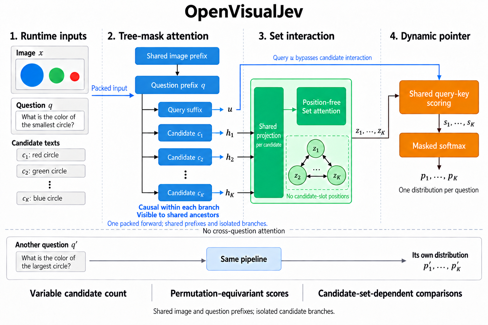

<h1 align="center">OpenVisualJev</h1>
<h3 align="center">多模态决策模型的设计与分析</h3>
<p align="center"><strong>Sheng Jin</strong><br>SenseTime Research and Tetras.AI</p>
<p align="center">
  <a href="paper/open-visualjev.pdf">论文</a> ·
  <a href="https://github.com/jin-s13/ai-research-writing-skill">研究与写作技能</a> ·
  <a href="README.md">English</a>
</p>

## 简介

**OpenVisualJev** 面向运行时定义的候选，直接输出多模态决策概率。模型以 **Qwen3-VL-4B** 为基座，将视觉语言表示与共享动态指针结合，用于图像识别和视觉问答。

- **动态候选：** 每道题通过自然语言候选定义自己的决策空间。
- **集合感知评分：** 独立候选编码与无位置集合交互支持联合比较和排列等变评分。
- **概率校准：** 校准感知训练与独立温度缩放共同调整输出概率。



图中展示 tree-mask 执行方式。论文主结果使用普通批处理分支；tree-mask 推理作为[显式选项](docs/tree-inference.md)提供。

## ai-research-writing-skill 的论文产出

**整篇论文是 [ai-research-writing-skill](https://github.com/jin-s13/ai-research-writing-skill) 端到端研究与写作流程的产出。** 在 Sheng Jin 的指导下，AI 辅助工作覆盖文献调研、方法与实验设计、代码实现、实验执行与分析、配图制作，以及论文起草和迭代修改。

实验结果来自实际模型运行及记录的评测脚本。作者指导研究方向、审阅证据与论文，并对最终工作负责。完整说明见论文中的 **AI usage disclosure**。

## 主要结果

采用 Qwen3-VL-4B、匹配的完整方法训练配置；识别实验使用一个训练种子。

| 评测 | 完整候选 LM | Set Pointer |
|---|---:|---:|
| 六集识别准确率 | 90.09% | **90.35%** |
| 候选换序后改变答案的题数 ↓ | 108 / 755 | **0 / 755** |
| 20 个困难候选下的识别准确率 | 80.26% | **82.06%** |

关系任务、自然 VQA、概率校准和组件分析见[论文](paper/open-visualjev.pdf)。

## 快速开始

已测试环境：Python 3.10、PyTorch 2.8.0、Transformers 4.57.3、PEFT 0.17.1，使用 CUDA 运行完整模型。

```bash
git clone https://github.com/jin-s13/OpenVisualJev.git
cd OpenVisualJev
python -m venv .venv
source .venv/bin/activate
pip install -e '.[vlm]'
```

请单独获取 [Qwen3-VL-4B-Instruct 基座](https://huggingface.co/Qwen/Qwen3-VL-4B-Instruct)。推理还需要训练后的 adapter/head bundle；**模型权重下载地址待发布**。准备方式见[模型资产](docs/assets.md)，也可按[训练指南](docs/training.md)生成 bundle。

```python
from open_visualjev.predictor import VisualChoicePredictor

model = VisualChoicePredictor(
    "/path/to/Qwen3-VL-4B-Instruct",
    "/path/to/checkpoint-bundle",
)
answers = model.predict("/path/to/image.jpg", [{
    "id": "animal",
    "question": "Which animal is shown?",
    "candidates": [
        {"id": "cat", "text": "a cat"},
        {"id": "dog", "text": "a dog"},
        {"id": "bird", "text": "a bird"},
    ],
}])
print(answers)
```

接口接收一张图片及一道或多道问题，每题支持 2–20 个候选，返回候选标识、logits 和概率。需要校准输出时，使用[校准推理接口](docs/calibration.md)。

## 训练与评测

| 任务 | 文档 |
|---|---|
| 准备图片与候选问题 | [数据格式](docs/data.md) |
| 使用自己的数据训练 | [训练](docs/training.md) |
| 评估预测与概率质量 | [评测](docs/evaluation.md) |

## 引用

```bibtex
@techreport{jin2026openvisualjev,
  title       = {{OpenVisualJev}: Design and Analysis of a Multimodal Decision Model},
  author      = {Jin, Sheng},
  institution = {SenseTime Research and Tetras.AI},
  year        = {2026},
  type        = {Technical Report},
  url         = {https://github.com/jin-s13/OpenVisualJev}
}
```

## 致谢与许可

本项目基于 [Qwen3-VL](https://github.com/QwenLM/Qwen3-VL)、PyTorch、Transformers 和 PEFT 构建。研究与写作流程使用 [ai-research-writing-skill](https://github.com/jin-s13/ai-research-writing-skill)。

代码采用 [MIT 许可证](LICENSE)。预训练模型、数据集与第三方资产遵循各自的许可。
